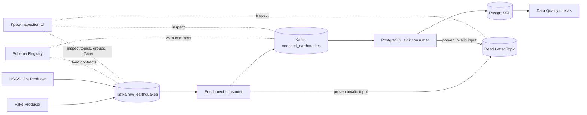

# Chilean Seismic Streaming Data Pipeline

[](https://github.com/rhonnydc/chile-seismic-streaming-pipeline/actions/workflows/ci.yml)

## The problem

Earthquake events arrive and can be updated continuously. Turning them into dependable analytical data involves more than polling an API: the pipeline needs explicit event contracts, recoverable processing, duplicate handling, invalid-input isolation, and checks on what was stored. This local project is inspired by Chilean seismic activity. Its default USGS feed covers the **world**; the live producer does not enforce a Chile-only geographic filter.

## What I built

A local-first, event-driven pipeline accepts synthetic earthquakes or polls the USGS GeoJSON feed. Both producers publish raw events to Kafka using a registered Avro contract. An independent consumer validates and enriches them into a second Avro topic; another consumer writes analytical rows to PostgreSQL. A primary key makes database replay idempotent. The consumers use manual offset commits, bounded retries for classified transient failures, and a shared dead-letter topic for proven invalid inputs. SQL-based data quality checks report failures after persistence. Kpow provides optional inspection of messages, schemas, groups, and offsets. Automated tests exercise the transformation, contracts, delivery boundaries, and real-service recovery paths.

## What it demonstrates

The project connects event contracts and consumer groups to observable delivery behavior: output delivery or a database transaction is confirmed before the corresponding input offset is committed. This yields **at-least-once processing**, with possible Kafka duplicates and an idempotent PostgreSQL result. Unit and contract tests cover the logic; isolated integration tests check Kafka messages, committed offsets, SQL rows, replay, dead-letter delivery, and recovery after a controlled database outage. Docker Compose and separate GitHub Actions jobs make these checks reproducible. [ADRs](docs/adr/README.md) record the design choices and their trade-offs.

## Architecture



Both consumers stop with the input offset pending for unclassified errors or exhausted infrastructure retries; only classified invalid inputs take the DLQ route. Kpow is optional and requires a local license. See [architecture](docs/architecture.md) and [retry and dead-letter handling](docs/retry-dead-letter.md) for the exact boundaries.

## Engineering quality and reliability

| Engineering practice | Implementation | Evidence |
| --- | --- | --- |
| Data contracts | Versioned raw and enriched Avro schemas; explicit Schema Registry registration with `BACKWARD_TRANSITIVE` compatibility | [Schemas](schemas/), [registration](scripts/register_schemas.py), [contract tests](tests/contracts/) |
| Delivery and offset management | Separate consumer groups; manual commits after enriched or DLQ delivery and after the database transaction | [Enricher](src/seismic_pipeline/consumers/enriching_consumer.py), [sink consumer](src/seismic_pipeline/consumers/postgres_sink_consumer.py), [end-to-end test](tests/integration/test_end_to_end.py) |
| Idempotent analytical storage | `event_id` primary key and `ON CONFLICT (event_id) DO NOTHING`; first stored version wins | [Table](sql/init.sql), [sink SQL](src/seismic_pipeline/sinks/postgres_sink.py), [replay test](tests/integration/test_replay.py) |
| Failure handling | Conservative error classification, at most three attempts for known transient operations, database reconnection on retry, and original Kafka bytes plus source coordinates in the DLQ | [Policy](src/seismic_pipeline/consumers/error_policy.py), [retry](src/seismic_pipeline/consumers/retry.py), [DLQ envelope](src/seismic_pipeline/consumers/dead_letter.py), [DLQ test](tests/integration/test_dead_letter_pipeline.py), [outage test](tests/integration/test_postgres_outage.py) |
| Data quality | Read-only SQL checks over a consistent PostgreSQL snapshot; PASS/FAIL report and nonzero failure exit | [Checks](src/seismic_pipeline/quality/checks.py), [runner](src/seismic_pipeline/quality/runner.py), [guide](docs/data-quality.md) |
| Reproducible verification | Fast offline gate plus isolated Kafka, Schema Registry, and PostgreSQL integration run with bounded waits and teardown | [Makefile](Makefile), [integration runner](scripts/run_integration.py), [CI workflow](.github/workflows/ci.yml), [integration guide](docs/integration-testing.md) |

These choices and their limits are documented in the [ADRs](docs/adr/README.md) and [recovery testing guide](docs/recovery-testing.md).

## Quick start

Requires Python 3.11+, Docker Compose v2, and Make. Kpow is optional for the pipeline; its UI needs a local license in `.env.kpow` as described in the [observability guide](docs/observability.md). From the repository root:

```bash
git clone https://github.com/rhonnydc/chile-seismic-streaming-pipeline.git
cd chile-seismic-streaming-pipeline
cp .env.example .env
python -m venv .venv
source .venv/bin/activate
make install
make up
make register-schemas
make create-topics
make init-db
```

On Windows PowerShell, use `Copy-Item .env.example .env` and `.\.venv\Scripts\Activate.ps1` instead of the `cp` and `source` commands. Wait for the Compose services to become ready before registering schemas. The producers require the schemas to be registered first.

Keep these long-running consumers in **separate terminals**, with the same virtual environment active:

```bash
# Terminal 1
make consume-enrich
```

```bash
# Terminal 2
make consume-sink
```

In a third terminal, publish synthetic events and query PostgreSQL:

```bash
make produce-fake
make query-db
make quality-checks
```

`make produce-live` polls the default worldwide USGS feed once instead; it depends on network access and may return no events. The sink stores the first row for each `event_id`, so later revisions of a USGS event do not replace it. `make query-db` runs the versioned [analytical queries](sql/analytics_queries.sql). Use `make down` when finished; it preserves the local data volumes. Make loads `.env`; direct Python commands do not.

## Testing and CI

```bash
make ci                # Ruff + unit, contract, and other service-independent tests
make test-integration  # isolated real-service integration suite
```

`make ci` calls `make lint` and `make test`; the latter runs `pytest -m "not integration"`. `make test-integration` starts a separate Docker Compose project with Kafka, Schema Registry, and PostgreSQL, creates run-specific topics and groups, runs `pytest -m integration`, then tears down its test containers and volumes. It has controlled readiness and test timeouts, and does **not** need a Kpow license. GitHub Actions runs the two commands in separate `checks` and `integration` jobs on pushes and pull requests.

The integration assertions inspect actual Kafka messages, committed offsets, and SQL rows. Scenarios cover end-to-end processing, sink replay without a duplicate row, invalid raw bytes routed to the DLQ, and an offset left pending through a controlled PostgreSQL outage until the sink restarts. See [integration testing](docs/integration-testing.md) and [recovery and replay](docs/recovery-testing.md). Integration tests do not exercise the live USGS HTTP service.

## Guarantees and scope

- Processing is at least once, **not end-to-end exactly once**. A crash after output delivery but before offset commit can duplicate an enriched or DLQ Kafka message. PostgreSQL idempotency prevents a second row for the same `event_id`; it does not deduplicate Kafka topics or apply later source updates.
- The local Kafka deployment has one broker. It does not demonstrate high availability after broker or disk loss. Persistent infrastructure or unexpected errors can stop a consumer and require manual investigation or restart; DLQ records are not automatically replayed.
- The default USGS feed is worldwide, with limited place-name inference for Chile and no strict geographic filter. This is a local-first implementation, not a cloud production deployment.

The completed project ends at **Phase 11**. Cloud deployment, Terraform, Apache Flink, stateful windowed aggregations, watermarks, distributed high availability, new observability tools, producers, dashboards, and business features are outside its scope. The unused metric schema is retained as a historical scaffold, not an implemented metrics stream. See the [closed roadmap](docs/roadmap.md).

## Further documentation

- [Architecture](docs/architecture.md) · [Data contracts](docs/data-contracts.md) · [Data quality](docs/data-quality.md) · [Observability](docs/observability.md)
- [Recovery and replay](docs/recovery-testing.md) · [Retry and DLQ](docs/retry-dead-letter.md) · [Integration testing](docs/integration-testing.md)
- [Architecture decisions](docs/adr/README.md) · [Technical decisions](docs/technical-decisions.md) · [Roadmap](docs/roadmap.md)
