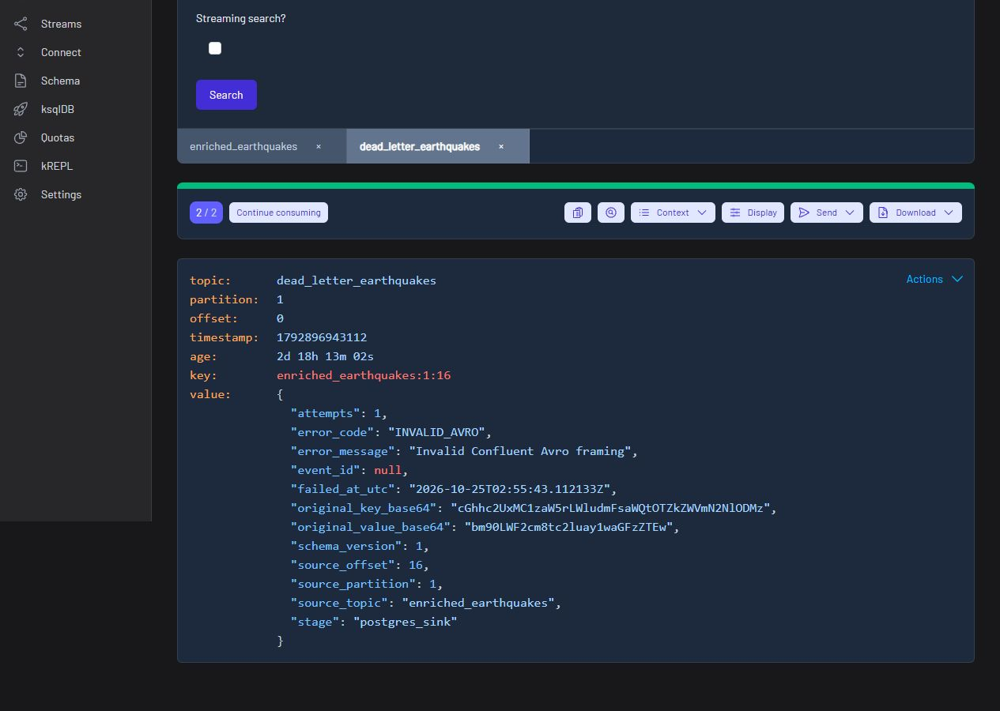

# Observability

## Scope

Kpow is the local Kafka inspection tool. Its UI requires a valid local license in `.env.kpow`; the data pipeline and integration tests do not require it.

The project does not include Prometheus, Grafana, alerting, distributed tracing, log aggregation, or production monitoring.

## Kpow Role

Kpow provides a browser UI for inspecting Kafka during local development. It is configured to publish at:

```text
http://localhost:3000
```

Inside Docker Compose, Kpow connects to:

```text
kafka:29092
schema-registry:8081
```

Kpow requires a local license before the UI is usable. Copy `.env.kpow.example` to `.env.kpow`, then fill the license values from the Kpow email. `.env.kpow` is ignored by Git.

## What Can Be Observed

With the local license configured, Kpow can inspect the `raw_earthquakes`, `enriched_earthquakes`, and `dead_letter_earthquakes` messages, the registered value schemas, consumer groups, offsets, and lag:

| Area | What it helps answer |
| --- | --- |
| Topics | Which topics exist, how many partitions they have, and how they are configured. |
| Messages | Whether events are being published and what their payloads look like. |
| Schemas | Which schemas are registered and how subjects evolve over time. |
| Consumer groups | Which applications are consuming from Kafka. |
| Offsets | How far each consumer group has read in each partition. |
| Consumer lag | Whether a consumer is falling behind the producer. |
| Partitions | How events are distributed across topic partitions. |

## Service checks

Basic service checks are:

```bash
docker compose ps
docker compose logs kafka
docker compose logs schema-registry
docker compose logs kpow
docker compose logs postgres
```

Kafka topics can be listed from inside the Kafka container:

```bash
docker compose exec kafka kafka-topics --bootstrap-server kafka:29092 --list
```

Schema Registry can be checked from the host:

```bash
curl http://localhost:8081/subjects
```

Before running `make create-topics`, a fresh stack may show only internal topics such as:

```text
__consumer_offsets
_schemas
```

Run `make create-topics` to create all three application topics, then run the producers and consumers to populate them.

## Enrichment checks in Kpow

After registering both schemas, creating both topics, and publishing fake raw events, start `make consume-enrich` (or the direct Python command in the README). With Kpow open at `http://localhost:3000`, check:

1. **Topics and messages:** `raw_earthquakes` contains Avro input; `enriched_earthquakes` receives Avro output with `event_id` keys and derived fields such as `severity_level`, `is_shallow`, and `processed_at_utc`.
2. **Schemas:** Schema Registry lists `raw_earthquakes-value` and `enriched_earthquakes-value`.
3. **Consumer group:** `seismic-enricher` consumes `raw_earthquakes`. Its members may disappear after the Python process stops, but the committed offsets remain associated with the group.
4. **Offsets:** The committed offset for a partition is the next record the group would read there. It advances after the corresponding enriched delivery succeeds.
5. **Lag:** Compare the partition's end offset with its committed offset. Lag should fall as the consumer processes queued raw events; if more raw events arrive, it can rise again.

The consumer logs `event_id`, source partition, and source offset after each successful commit. Phase 4 stopped without committing on an invalid input or output delivery failure. Phase 10 now isolates proven invalid inputs in a DLQ after a delivery acknowledgement; unknown and infrastructure failures still stop with the offset pending.

## PostgreSQL sink checks

Start the Postgres sink consumer after the table has been initialized with `make init-db` (or the equivalent `psql` command). Keep the enricher and sink in separate terminals, then publish fake events. The sink logs `event_id`, whether the row was newly inserted, the enriched topic partition and offset, and its consumer group after each successful Kafka offset commit.

In Kpow, inspect `enriched_earthquakes` and the `seismic-postgres-sink` consumer group:

1. **Input:** Enriched Avro messages are available with the expected `event_id` keys and derived fields.
2. **Group:** `seismic-postgres-sink` subscribes to `enriched_earthquakes`, separately from `seismic-enricher` on `raw_earthquakes`.
3. **Offsets and lag:** Committed offsets advance only after the matching Postgres write commits. Once all available messages have been handled, lag should reach zero. A stopped consumer may no longer appear as an active member, while its committed offsets remain.

Check the database separately; Kpow does not show Postgres rows:

```bash
docker compose exec -T postgres psql -U seismic_user -d seismic -c "SELECT COUNT(*) FROM enriched_earthquake_events;"
docker compose exec -T postgres psql -U seismic_user -d seismic -c "SELECT event_id, region, magnitude, severity_level, stored_at_utc FROM enriched_earthquake_events ORDER BY stored_at_utc DESC LIMIT 10;"
```

Run `make query-db` (or `sql/analytics_queries.sql` through `psql`) for the four analytical views of the stored events. A zero-lag group means its offsets caught up with Kafka at that moment; compare it with Postgres rows and sink logs to verify persistence. Replaying an event may log `inserted=False` because `ON CONFLICT (event_id) DO NOTHING` kept the existing row. Phase 10 retries known connection failures and isolates proven invalid inputs; other failures leave the offset uncommitted and stop the consumer.

## Recovery evidence

See [Fault Recovery and Replay Testing](recovery-testing.md) for reproducible local steps and
observed offsets, Python logs, and SQL results for consumer restarts, Postgres failure, and
replays across both commit boundaries. Kpow can cross-check group membership and lag, while SQL
is needed to verify that a replay leaves one Postgres row per `event_id`.

## DLQ checks

See [Retry and Dead-Letter Handling](retry-dead-letter.md) for the shared
`dead_letter_earthquakes` JSON contract, the Kpow Data → Inspect procedure,
CLI offset checks, and the controlled two-consumer run. Compare the DLQ
record's source topic, partition, and offset with the affected group's
committed position. Logs distinguish a bounded retry, a DLQ delivery, and a
consumer stopping on an unresolved infrastructure or unexpected error.

## Dead-letter evidence

This Kpow capture shows an existing `dead_letter_earthquakes` record from the PostgreSQL sink. It includes `INVALID_AVRO`, the source topic, partition, offset, and original bytes in base64. The screenshot documents isolation of this message; the behavior around failure and recovery is verified by the [integration tests](integration-testing.md).


